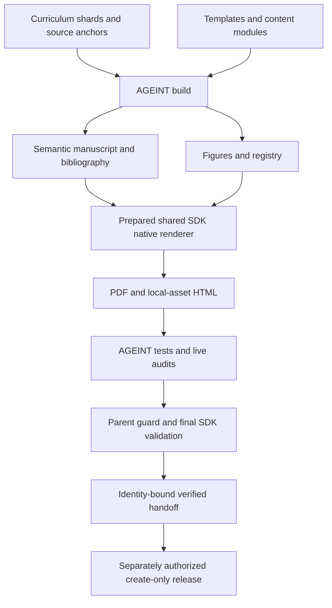

# AGEINT — Agentic Intelligence Curriculum

A source-built atlas, library, course, textbook, cookbook, and playbook for
**Agentic Intelligence**. AGEINT turns curriculum shards and evidence-scoped
research anchors into a semantic manuscript, figures, bibliography, and
inspectable reports. The shared research SDK compiles the PDF and HTML editions.

**Read:** [PDF snapshot](AGEINT.pdf) · [published releases](https://github.com/docxology/AGEINT/releases) · [documentation](docs/README.md)  
**Work:** [commands](#commands) · [source map](#source) · [verification and releases](#github-actions-and-releases) · [troubleshooting](#troubleshooting)

**Source edition: 0.2.0.** A version in source, a checked-in reader, or an old
`ok: true` report is not proof that this edition has been published or freshly
qualified. Full publication requires the genuinely released SDK **v5.1.0** and
the exact-source acceptance workflow. See [current state](#current-state-and-next-actions)
and [citation and DOI](#citation-and-doi) before reusing an artifact.

## Read and learn

| Your goal | Start here | A useful result |
| --- | --- | --- |
| Read the curriculum | [PDF](AGEINT.pdf), or an HTML reader from a verified release | Follow the orientation, a unit workflow, then its chapter exercises |
| Study independently | [Learner support and assessment](docs/learner_support_assessment.md) | Record a bounded claim, its sources, alternatives, limits, and a justified decision or abstention |
| Teach or facilitate | [Instructor guide](docs/instructor_guide.md) | Select a learning path, use fictional/synthetic cases, and assess the evidence trail rather than confidence alone |
| Improve content or citations | [Source map](#source) and [citation workflow](docs/citation_workflow.md) | Change authored source, preserve identities, rebuild, and inspect the resulting reader |
| Build or verify an edition | [Commands](#commands) and [Actions contracts](.github/workflows/README.md) | Produce artifacts whose Source, SDK, clock, tests, and audit evidence agree |

The curriculum covers intelligence tradecraft, OSINT/GEOINT integrity,
FININT/economic security, intelligence history, agentic-AI governance,
cognitive security, counterintelligence, cyber defense, and ICS/OT readiness.
Human-source subjects and software agents are distinct; exercises remain
educational, defensive, synthetic, accountable, and subject to legal and human
oversight. They are not live-target operating instructions.

### Open the HTML reader locally

GitHub's HTML file preview is **not** the running book. From a checkout that
contains `output/web/index.html`, serve the common output root:

```bash
# Working directory: AGEINT repository root. No SDK is needed to serve existing files.
python3 -m http.server 8000 --bind 127.0.0.1 --directory output
```

Open <http://127.0.0.1:8000/web/index.html>. Keep `web/`, its local browser
assets, and sibling `figures/` together; serving only `output/web/` breaks
relative figure URLs. This reads an existing snapshot, not a fresh build.
If the checkout has no HTML edition, use the PDF or a verified reader bundle.
Do not assume every reader feature works through `file://`.

For a downloaded `AGEINT-reader.zip`, use a new extraction directory:

```bash
unzip AGEINT-reader.zip -d reader
python3 -m http.server 8000 --bind 127.0.0.1 --directory reader
```

Open the same `/web/index.html` URL. Runtime assets are local; scholarly links
remain external references that you choose to open.

## Current generated scope

These are the documented source/generated-snapshot counts, not a new release
measurement or an effectiveness claim. Inspect or rebuild the corresponding
source before reporting changed counts.

| Surface | Count | Source of truth |
| --- | ---: | --- |
| Parts | 16 | `data/curriculum/stats.json` |
| Chapters | 51 | `data/curriculum/stats.json` |
| Methods appendices | 9 | `data/curriculum/stats.json` |
| AGEINT patterns | 20 | `output/data/curriculum_outline.json` |
| Parsed guide references | 312 | `data/curriculum/references/` |
| Curated research anchors | 462 | `data/research_anchors/` |
| Source-quality support anchors | 10 | `data/research_anchors/source-quality-anchors.jsonl` |
| Source-metadata rows | 472 | `output/reports/source_metadata.json` |
| Registered figures | 177 | `output/figures/figure_registry.json` |

The numbered registry contains 115 Mermaid, 52 Python, 4 historical, and
6 AI-generated figures. Non-numbered cover and Evidence Transit Map assets
live outside that registry. Inspect their provenance rather than treating a
figure count, caption, or successful render as evidence for a scientific claim.

Read the existing curriculum snapshot without rebuilding:

```bash
python3 -c "import json; from pathlib import Path; print(json.loads(Path('output/data/curriculum_outline.json').read_text())['stats'])"
```

Historical measurements are in [TODO's historical verification section](TODO.md#historical-pre-refactor-verification-2026-11-06),
not a nonexistent "Verified State" section. Current work is in
[Open](TODO.md#open) and the native [taskboard](tasks.yaml).

## Commands

Examples use a POSIX-style shell. Git and [uv](https://docs.astral.sh/uv/getting-started/installation/)
are needed for development; Python alone can serve existing readers. Use an
empty destination or a separate development checkout. Builds and report writers
modify files: preserve local changes and original failed evidence first.

### 1. Standalone development — compile sources, not a release book

AGEINT's standalone compatibility floor is **Python 3.11**; the checkout's
[`.python-version`](.python-version) selects its default development interpreter.
Start outside an activated SDK environment so nested uv commands do not
reconcile the SDK's frozen environment against AGEINT's different dependency
metadata.

```bash
git clone https://github.com/docxology/AGEINT.git AGEINT-dev
cd AGEINT-dev
uv sync --locked --extra dev

# Compiles source data, variables, bibliography, manuscript, and figures.
# This writes generated files; it does not compile the PDF/HTML book.
uv run --no-sync python scripts/build_curriculum.py
```

The build already generates figures; do **not** follow it with another complete
`generate_figures.py` run. Default development rendering may use deterministic
text-plate fallbacks when Mermaid/browser tooling is unavailable. That result
is useful for development, **not strict reader or release acceptance**.

A focused source-identity check is:

```bash
uv run --no-sync python -m pytest tests/test_source_identity.py
```

The limited standalone CI lane additionally prepares Poppler and runs:

```bash
uv run --no-sync python -m pytest tests/   --cov=src --cov-report=term-missing --cov-fail-under=84
```

That **84% compatibility lane does not replace the full 90% acceptance gate**.
Tests can build missing/stale fixtures when an SDK is discoverable; they are not
universally read-only. Do not rebuild a checked-in publication merely to hide
its original freshness/count/heading failures. Diagnose it as found; use the
separate fresh-checkout acceptance workflow for a newly built edition.

### 2. Full PDF/HTML workflow — prepared, pinned shared SDK

**Prerequisite:** a genuinely published, non-draft, non-prerelease SDK
[`v5.1.0`](https://github.com/docxology/template/releases/tag/v5.1.0), plus its
native document toolchain. If that release is unavailable, stop this stable
route; do not substitute floating `main` or relabel a development candidate.
[Manual candidate verification](#github-actions-and-releases) is a separate,
non-publication route.

The SDK requires Python **3.14 or later**; the complete hosted AGEINT lane uses
**3.14**. AGEINT does not install a second compiler. Prepare the SDK's pinned
Mermaid/Node/browser, Pandoc/crossref, XeLaTeX/BibTeX, and native-reader tools
using its own setup instructions. AGEINT's standalone `uv sync` does not
provision these system tools. The [hosted verification workflow](.github/workflows/manuscript.yml)
uses the SDK's setup actions for a reproducible prepared environment.

From a new parent directory, clone AGEINT **inside** the SDK as a regular
checkout, not an external symlink. Offline asset publication enforces confinement.
The `projects/active/` checkout is local project state, not something to add to
the SDK's public tracked tree.

```bash
git clone --branch v5.1.0 --recurse-submodules   https://github.com/docxology/template.git template
cd template
git clone https://github.com/docxology/AGEINT.git projects/active/AGEINT

# Working directory remains the SDK root.
uv sync --frozen --group dev --group rendering --python 3.14
export AGEINT_TEMPLATE_REPO="$PWD"
export VIRTUAL_ENV="$PWD/.venv" UV_PROJECT_ENVIRONMENT="$PWD/.venv"
export UV_PYTHON="$PWD/.venv/bin/python" UV_NO_SYNC=1 UV_FROZEN=true
export PATH="$PWD/.venv/bin:$PATH"
export PYTHONPATH="$PWD:$PWD/projects/active/AGEINT/src"
export SOURCE_DATE_EPOCH="$(git -C projects/active/AGEINT log -1 --format=%ct)"
export AGEINT_REQUIRE_RENDERED_FIGURES=1
export ENABLE_PDF=1 ENABLE_HTML=1 ENABLE_SLIDES=0 ENABLE_DOCX=0 ENABLE_EPUB=0

python -m infrastructure.reporting.native_dependency_preparation --repo-root .
(cd projects/active/AGEINT && python scripts/build_curriculum.py)

python -m infrastructure.validation.cli markdown   projects/active/AGEINT/output/manuscript --repo-root . --strict
python -m infrastructure.validation.cli prerender   projects/active/AGEINT/output/manuscript --repo-root .
python scripts/pipeline/stage_03_render.py   --project active/AGEINT --skip-manuscript-hydration
python -m infrastructure.validation.cli pdf   projects/active/AGEINT/output/pdf/AGEINT_combined.pdf
python scripts/pipeline/stage_04_validate.py --project active/AGEINT

# Mirror the authoritative PDF; do not compile a second root PDF.
cp projects/active/AGEINT/output/pdf/AGEINT_combined.pdf   projects/active/AGEINT/AGEINT.pdf
```

`AGEINT_TEMPLATE_REPO` selects a checkout; it does not install the SDK or waive
its runtime/guard requirements. Keep using the selected SDK Python. Do not run
a new standalone dependency sync over this prepared environment.

`--skip-manuscript-hydration` preserves AGEINT's already generated semantic
manuscript. The native renderer owns the PDF/HTML. `stage_05_copy.py` is optional
copied-output packaging, not a replacement for native rendering.

### 3. Verification and audits

From AGEINT's root **in that same prepared SDK environment**, run the complete
suite before claiming a newly rendered edition is qualified:

```bash
cd "$AGEINT_TEMPLATE_REPO/projects/active/AGEINT"
python -m pytest tests/ --cov=src --cov-fail-under=90
python scripts/audit_release_metadata.py --expected-tag v0.2.0 --format json
```

The complete workflow inventories reader bytes before and after tests and
rejects mutation. A passing local test command is not the exact-source hosted
acceptance handoff, nor permission to promote or publish outputs.

Audit commands run from AGEINT's root with its prepared interpreter. Default
output is Markdown on stdout; `--format json` selects JSON stdout. Nonzero
means a failing report or a CLI/runtime error, not a reason to suppress a gate.

| Script under `scripts/` | Checks | Saved report with `--write` |
| --- | --- | --- |
| `audit_scholarship_quality.py` | Citation/support structure | `scholarship_quality.{json,md}` |
| `audit_source_metadata.py` | Explicit source lane/tier metadata | `source_metadata.{json,md}` |
| `audit_agency_source_coverage.py` | Agency/pack/routing coverage | `agency_source_coverage.{json,md}` |
| `audit_claim_calibration.py` | Evidence and claim-boundary language | `claim_calibration.{json,md}` |
| `audit_reference_quality.py` | Resolvable, informative references/headings | `reference_quality.{json,md}` |
| `audit_orchestration_contract.py` | Native build/audit/source-pack contracts | `orchestration_contract.{json,md}` |
| `audit_source_refresh_due.py` | Review-date/cadence metadata | `source_refresh_due.{json,md}` |
| `audit_artifact_evidence.py` | Live aggregate artifact evidence | `current_artifact_evidence.{json,md}` |
| `audit_publication_readiness.py` | Aggregate readiness and actual SDK parent guard | `publication_readiness.{json,md}` |
| `audit_heading_support.py` | Generated heading support | No `--write`; stdout only |
| `audit_pdf_quality.py` | PDF/manuscript quality | No `--write`; stdout only |
| `audit_release_metadata.py` | Version/tag/source metadata alignment | No `--write`; stdout only |

Saved report pairs live under `output/reports/`. `--write --format json` still
writes **both** JSON and Markdown. Artifact-evidence writing also refreshes six
subordinate report pairs; it is not a read-only command.

After intentional build/render work, collect evidence in the existing order:

```bash
python scripts/audit_scholarship_quality.py --write --format json
python scripts/audit_source_metadata.py --write --format json
python scripts/audit_agency_source_coverage.py --write --format json
python scripts/audit_claim_calibration.py --write --format json
python scripts/audit_reference_quality.py --write --format json
python scripts/audit_orchestration_contract.py --write --format json
python scripts/audit_source_refresh_due.py --write --format json
python scripts/audit_heading_support.py --format json
python scripts/audit_pdf_quality.py --format json
python scripts/audit_artifact_evidence.py --write --format json
python scripts/audit_publication_readiness.py --write --format json

# Final read-only readiness recheck, not authorization to publish.
python scripts/audit_publication_readiness.py --format json
```

The hosted lane additionally reruns SDK stage 04 **after** report writers and
packages only the unchanged validated bytes. See its
[full acceptance order](.github/workflows/manuscript.yml).

The readiness command runs the **actual parent guard**. A missing, failed,
timed-out, or skipped guard blocks readiness. `--skip-parent-guard` is
informational and cannot produce passing acceptance. `ok` is local preflight
evidence, not proof of source entailment, learning gains, legal compliance,
production safety, hosted acceptance, a Git tag, or a DOI deposit.

### Focused refreshes and reproducible clocks

Use these only for their stated scope; neither replaces the full workflow:

```bash
# AGEINT root, prepared environment: refresh figures without a full build.
python scripts/generate_figures.py --no-allow-placeholder-figures

# Inspect existing reports/inputs without requesting report-file writes.
python scripts/audit_artifact_evidence.py --format json
python scripts/audit_source_refresh_due.py --format json
```

`SOURCE_DATE_EPOCH` pins the UTC build instant for byte-comparable generation.
Reuse the producer's epoch when reproducing its evidence; do not backdate a run
to hide overdue source reviews. Invalid/negative epochs fail. A deterministic
clock does not mean every source was freshly retrieved. Review-date audits
inspect metadata, not live URLs or the truth of a claim.

`--regenerate-source-template-library` (also `--regenerate-source-templates`)
on `build_curriculum.py` deliberately resets the neutral authored template
library. It is **not** an ordinary rebuild option; preserve intentional template
edits before using it. There is no output-directory or PDF switch on that CLI.

## GitHub Actions and releases

| Workflow | Purpose | Boundary |
| --- | --- | --- |
| [CI](.github/workflows/ci.yml) | Locked lint; Python 3.11/3.12/3.15 standalone compatibility; complete verification job | Standalone 84% coverage is not release acceptance |
| [Complete manuscript verification](.github/workflows/manuscript.yml) | Strict fresh build, genuine SDK PDF/HTML, ≥90% tests, reader immutability, native and aggregate gates, actual parent guard | Stable SDK by default; manual immutable candidate is development-only |
| [Source freshness](.github/workflows/source-freshness.yml) | Scheduled/manual review-date and cadence checks | Not live source retrieval; remote run may create drift issues |
| [Release AGEINT](.github/workflows/release.yml) | Exact-main acceptance, identity/hash handoff, create-only tag and release | Maintainer publication action, not a verification shortcut |

Authenticated GitHub CLI users can inspect and deliberately dispatch verification:

```bash
gh run list --repo docxology/AGEINT --workflow ci.yml --limit 5
gh run list --repo docxology/AGEINT --workflow manuscript.yml --limit 5

# Submits verification work, not publication; stable SDK must exist.
gh workflow run manuscript.yml --repo docxology/AGEINT --ref main
```

For manual development against a reviewed immutable SDK candidate:

```bash
: "${SDK_CANDIDATE_SHA:?Set the reviewed full lowercase 40-hex SDK commit SHA}"
gh workflow run manuscript.yml --repo docxology/AGEINT --ref main   -f "sdk-candidate=$SDK_CANDIDATE_SHA"
```

The workflow checks the exact checkout and records candidate identity. It does
not convert candidate results into stable-SDK release evidence. No floating
branch or candidate override is allowed for publication.

After selecting the exact run, use a new download directory:

```bash
: "${AGEINT_RUN_ID:?Set the exact completed verification run ID}"
gh run watch "$AGEINT_RUN_ID" --repo docxology/AGEINT --exit-status
gh run download "$AGEINT_RUN_ID" --repo docxology/AGEINT --dir verified
(cd verified/verified-ageint-* && shasum -a 256 --check SHA256SUMS)
```

Only a successful `verified-ageint-<source>-<run-id>-<attempt>` handoff is
acceptance evidence. `ageint-inspection-only-*` explicitly says
`acceptance: false`; `ageint-diagnostics-only-*` retains failure evidence.
Neither can replace the verified artifact. Actions artifacts are retained for
14 days; do not confuse that operational retention with archival publication.

The verified handoff contains `AGEINT.pdf`, `AGEINT-reader.zip`,
`AGEINT-evidence.zip`, `AGEINT-generated.tar.gz`, `source-sdk.json`, and
`SHA256SUMS`. Check all hashes and the exact AGEINT/SDK/run/attempt identity
before reuse or reviewed generated-output promotion. Preserve local edits and
original reports; never replace them with an inspection snapshot to imply success.

### Maintainer publication only

Before dispatch, source version/edition/CFF metadata must agree; the current
version's native task milestone and its explicit prerequisites must qualify;
Source must be exact current `main`; the stable SDK release must exist; and
publication must be authorized. Do **not** pre-create the tag:

```bash
# PUBLICATION ACTION: creates a new tag and GitHub release after fresh acceptance.
gh workflow run release.yml --repo docxology/AGEINT --ref main -f tag=v0.2.0
```

Release reruns complete acceptance rather than trusting a previous green run,
rechecks current `main` and stable SDK identity, and verifies same-run asset
hashes. Existing tags/releases are refused, not moved or overwritten. A partial
publication can leave a tag; do not delete or move it to force a retry. A
configured archive integration may have separate consequences and approvals.
Source metadata and this README do not authorize a new deposit or mint a DOI.

## Source

| Change | Authoritative surface | Follow through |
| --- | --- | --- |
| Curriculum/topic content | `data/curriculum/`, especially chapter `sections.jsonl` | Shard-first build; inspect generated reader and evidence boundaries |
| Neutral templates and reader structure | `docs/manuscript/templates/`, `src/manuscript_manifest/`, `src/intelligence_content/` | Rebuild; validate headings, references, citations, and reader navigation |
| Sources and citations | `data/research_anchors/`, `data/source_identity/`, source-pack YAML, `src/manuscript_variables/` | Follow [citation workflow](docs/citation_workflow.md); preserve locked keys/identities, append new references |
| Figures | `src/figures/`, declarative source tables, registry producers | Real render plus caption/alt-text/provenance review; no placeholder qualification |
| Build/audit behavior | `src/` business logic; thin wrappers in `scripts/` | Update behavioral consumers and [orchestration contracts](docs/orchestration_contract.md) |
| Version and publication | `pyproject.toml`, `CITATION.cff`, manuscript/book config, `tasks.yaml` | Version-derived prerequisites and exact-source release workflow |

When present, `SIST-Guide-TOC-and-Bibliography-v2.md` is an optional historical
input. Normal builds use curriculum shards without restoring that file. Do not
reintroduce numbered authored chapters under `docs/manuscript/` or hand-edit
`output/manuscript/`: source templates and manifest/content modules own it.
Use Pandoc citation/cross-reference labels rather than hard-coded figure,
section, or equation numbers. [Syntax guide](docs/syntax_guide.md).

## Architecture



AGEINT owns curriculum composition, authored/generated boundaries, source
metadata, figure registry, and release gates. The SDK owns native rendering;
there is no second Pandoc/TeX/BibTeX driver here. The build writes a source-bound
stamp only after its producers complete. Generated readers and audit records
remain evidence with specific identities, not primary authoring surfaces.

## Current state and next actions

| Surface | Authority |
| --- | --- |
| [`TODO.md`](TODO.md#open) | Human next actions and separately deferred author decisions |
| [`tasks.yaml`](tasks.yaml) | Native taskboard source and version-derived release dependencies |
| [`ISA.md`](ISA.md), [`CHANGELOG.md`](CHANGELOG.md) | Historical execution/change records, not a second active backlog |
| `output/reports/current_artifact_evidence.{json,md}` | Recomputed artifact evidence for its own source/run |
| `output/reports/publication_readiness.{json,md}` | Evaluated local preflight gates, not publication authority |
| Matching GitHub verification/release | Exact-source hosted acceptance and actual publication records |

Do not duplicate open work in another task format or infer that a taskboard
server is connected merely because a YAML header names it. Inspect report
identity, source freshness, guard execution, and unmet prerequisites—not just
`ok`. Checked-in historical reports may predate the current contract; an old
successful candidate or release milestone cannot qualify today's source.

## Troubleshooting

| Symptom | Check / safe next action |
| --- | --- |
| Wrong interpreter or SDK import errors | Use one prepared SDK environment for the full route; check `AGEINT_TEMPLATE_REPO` and explicit interpreter/cwd. Do not sync standalone metadata over that environment. |
| Missing stable SDK tag/release | Stop the stable path; wait for the genuine release or use explicitly marked manual candidate verification for development only. |
| Mermaid/browser missing or fallback plates | Prepare the SDK's pinned native toolchain; use strict rendering. A text plate or permissive build is not acceptance. |
| HTML has missing figures/math or incomplete context | Serve the common bundle/output root over HTTP; use canonical `web/index.html`, not isolated section previews or a `file://` assumption. |
| Stale build stamp, counts, references, or heading support | Preserve the failure and local edits; correct authored inputs and intentionally produce a fresh edition in a separate checkout. Do not alter counts or suppress the check. |
| Parent guard skipped, missing, failed, or timed out | Run the real guard in the compatible prepared SDK context. Skipping it cannot close readiness. |
| Overdue/invalid source-review dates | Inspect [refresh ledger](docs/source_refresh_ledger.md) and original sources; record a real review. Changing a date is not verification. |
| Existing tag/release or mismatched asset hash | Stop publication; inspect the exact source/run/assets. Do not clobber, retag, or mix artifacts. |

See [troubleshooting](docs/troubleshooting.md), [rendering pipeline](docs/rendering_pipeline.md),
and [Actions contracts](.github/workflows/README.md) for detailed diagnostics.

## Scholarship posture

Discovery tools provide leads, not verification. Bind claims to directly
inspected official, standards, public-domain, or scholarly sources; preserve
access limits, corrections, uncertainty, and source dependence. The locked
`ageint001`–`ageint231` reference identities remain stable; additions are
append-only, with the documented guide range through `ageint312`.

The source layer covers governance, accessibility, procurement, incident
response, red-team assurance, provenance, rights/privacy, intelligence
tradecraft, and agent interoperability. Source annotations and metadata are
editorial context, not manufactured evidence. A populated metadata row or a
successful rebuild is not a fresh review of every source.

Structural/heuristic audit success does **not** establish passage entailment,
independent corroboration, learning gains, model reliability, legal compliance,
production safety, diagnostic validity, or live-model effectiveness. ACH
consistency is not a Bayesian likelihood ratio. Proposed cognitive-security
frameworks or candidate neuromarkers are not validated assurance claims.
See [source lanes](docs/source_lane_map.md), [source identity](docs/source_identity_stability.md),
[research](docs/research.md), and [adversarial assurance](docs/adversarial_assurance.md).

## Citation and DOI

- Repository: <https://github.com/docxology/AGEINT>.
- Concept DOI, identifying the archived work: [10.5281/zenodo.20732274](https://doi.org/10.5281/zenodo.20732274).
- Historical **Edition 0.1.0 only**: [10.5281/zenodo.20732275](https://doi.org/10.5281/zenodo.20732275).
- Machine-readable citation: [`CITATION.cff`](CITATION.cff), from the edition you actually use.
- [License](LICENSE): curriculum/manuscript/docs/figures **CC BY 4.0**; code/scripts/tests/config/workflows **Apache-2.0**.

> Friedman, Daniel Ari. *AGEINT: Agentic Intelligence — A Modular Atlas, Library,
> Course, Textbook, Cookbook, and Playbook for Agentic Intelligence* (source
> edition 0.2.0, 2026). Active Inference Institute.
> <https://github.com/docxology/AGEINT>. <https://doi.org/10.5281/zenodo.20732274>.

Source publication identity is rendered into the title/citation surface. The
concept DOI does not mint or establish a new 0.2.0 version DOI/deposit. Cite an
archived edition's actual version DOI when edition-specific provenance matters.

## Safety posture

Dual-use subjects are history, governance, tabletop exercises, synthetic-data
labs, public-domain imagery, source-integrity review, and defensive analysis.
Do not add live target lists, operational collection steps, evasion recipes,
exploit instructions, manipulation playbooks, covert-action procedures, or
unsafe cyber-physical actions. Retain human review, permission, rights, and
accountability boundaries.

## Further documentation

[Documentation hub](docs/README.md) · [quickstart](docs/quickstart.md) ·
[instructor guide](docs/instructor_guide.md) · [learner support](docs/learner_support_assessment.md) ·
[citation workflow](docs/citation_workflow.md) · [output inventory](docs/output_inventory.md) ·
[readiness](docs/publication_readiness.md) · [forking](docs/forking_guide.md) ·
[agent rules](AGENTS.md) · [scripts](scripts/README.md)

## Dated research notes

Original [source and curriculum chronology](docs/research_history.md) is preserved
separately so this workflow guide stays bounded. Dated counts and verification
wording are historical, not current acceptance or a fresh review of every source.
